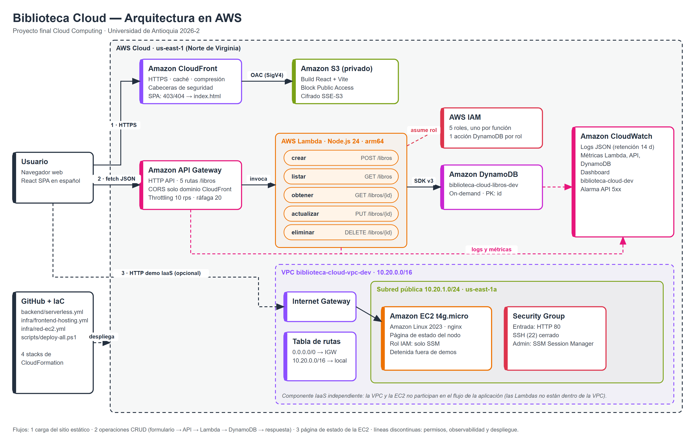

# Biblioteca Cloud

Proyecto final de **Cloud Computing (Universidad de Antioquia, 2026-2)**. Es una aplicación web para gestionar un catálogo de libros, desplegada en AWS con:

- un frontend estático (React + Vite) en S3, servido por CloudFront;
- un backend serverless: API Gateway, cinco funciones Lambda y DynamoDB;
- un componente IaaS: una VPC propia con subred pública y una instancia EC2;
- seguridad con IAM de mínimo privilegio, observabilidad en CloudWatch y estimación de costos.

**Docente:** Juan Pablo Arango
**Integrantes:** Santiago Palacio Cárdenas · Juan Esteban Mosquera · María Paula Mosquera

| Recurso | URL |
| --- | --- |
| Aplicación web (CloudFront, HTTPS) | https://d2eefcjglj9a9z.cloudfront.net |
| API REST (API Gateway HTTP API) | https://zjl2czbrvk.execute-api.us-east-1.amazonaws.com/libros |
| Repositorio | https://github.com/spalacioc05/biblioteca-cloud-proyecto-final |

> La instancia EC2 de demostración se mantiene **detenida** para no generar costos. Se inicia con `scripts/ec2.ps1 -Accion iniciar` cuando se va a mostrar.



## Qué hace la aplicación

- Muestra el catálogo en tarjetas, con un resumen de libros totales, disponibles y prestados.
- Busca por título o autor, sin importar mayúsculas ni tildes.
- Filtra por género y por disponibilidad.
- Registra libros con validación en el formulario y también en el backend.
- Muestra el detalle de un libro, consultado con `GET /libros/{id}`.
- Edita un libro o lo marca como prestado o disponible con un clic.
- Elimina un libro después de pedir confirmación.
- Muestra estados de carga, vacío y error, y avisos de éxito o error. Es responsive y tiene en cuenta la accesibilidad (diálogos nativos, etiquetas y regiones `aria-live`).

Todos los datos se leen y se escriben en DynamoDB a través de la API; la aplicación no usa datos simulados.

## Del Laboratorio 3 al proyecto final

El punto de partida fue el repositorio [`lab3-serverless-libros`](https://github.com/spalacioc05/lab3-serverless-libros), una API CRUD de libros que se probaba con Postman. Ese repositorio y su stack (`lab3-serverless-libros-dev`) **no se modificaron**: este proyecto usa servicio, tabla, roles y stacks con nombres nuevos.

| Se reutilizó del Laboratorio 3 | Se construyó para el proyecto final |
| --- | --- |
| Las 5 funciones CRUD y el modelo `libro` | Frontend React + Vite completo, en español y responsive |
| Serverless Framework + HTTP API + DynamoDB | S3 privado + CloudFront + OAC (IaC en CloudFormation) |
| | VPC, subred pública, IGW, tabla de rutas, SG y EC2 (IaC) |
| | Un rol IAM por función con una sola acción de DynamoDB |
| | CORS restringido al dominio real y límite de peticiones en la API |
| | Validaciones con límites, control de id, tamaño de cuerpo y Scan paginado |
| | Logs JSON estructurados, dashboard y alarma en CloudWatch |
| | 11 pruebas unitarias y 15 pruebas de humo contra AWS |

## Estructura del repositorio

```
backend/              API serverless (Serverless Framework v4)
  serverless.yml      Lambda, API Gateway, DynamoDB, roles IAM, dashboard y alarma
  src/                handler.js, validacion.js, http.js, db.js
  tests/              pruebas unitarias (node:test)
  iam/, monitoring/   política de confianza y definición del dashboard
  postman/            colección heredada del Laboratorio 3
frontend/             aplicación React + Vite
infra/
  frontend-hosting.yml  S3 privado + CloudFront + OAC (CloudFormation)
  red-ec2.yml           VPC + subred pública + IGW + rutas + SG + EC2 (CloudFormation)
scripts/
  deploy-all.ps1      despliegue completo en orden
  deploy-frontend.ps1 build con la URL real de la API, publicación en S3 e invalidación de CloudFront
  ec2.ps1             iniciar, detener o consultar la EC2
  seed.mjs            carga libros de demostración por la API
  smoke-test.mjs      pruebas de humo contra la infraestructura real
docs/                 arquitectura (diagrama SVG/PNG/draw.io)
```

## Requisitos

- Node.js 20 o superior (probado con 24) y npm
- AWS CLI v2 autenticada (`aws login` o un perfil) en `us-east-1`
- Serverless Framework v4 (`npm i -g serverless`), con sesión iniciada
- PowerShell 7 para los scripts

## Despliegue

```powershell
# Todo en orden: hosting -> backend -> frontend (y la red IaaS con -ConRed)
pwsh ./scripts/deploy-all.ps1 -Stage dev -ConRed

# Cargar libros de demostración (obras publicadas, sin datos personales)
node scripts/seed.mjs https://<api-id>.execute-api.us-east-1.amazonaws.com
```

El backend lee la URL de CloudFront desde las salidas del stack `biblioteca-cloud-frontend-<stage>` para configurar CORS. Por eso el stack de hosting se despliega primero.

### Desarrollo local

```powershell
cd frontend
copy .env.example .env.local   # pon la URL de la API en VITE_API_URL
npm install
npm run dev                    # http://localhost:5173 (origen permitido en CORS)
```

## Pruebas

```powershell
cd backend; npm test                       # 11 pruebas unitarias (DynamoDB simulado)
cd frontend; npm run lint; npm run build
node scripts/smoke-test.mjs <URL API> <URL CloudFront> <bucket>   # 15 pruebas contra AWS
```

Las pruebas de humo cubren: el frontend por HTTPS, el fallback de la SPA, el bloqueo del acceso directo a S3 (403), el CRUD completo con códigos 201, 200, 400 y 404, y CORS (origen permitido y origen rechazado). El libro que crean se elimina al terminar.

## API

| Método | Ruta | Respuestas |
| --- | --- | --- |
| POST | `/libros` | 201 creado · 400 validación · 413 cuerpo > 10 KB |
| GET | `/libros` | 200 lista ordenada por fecha de creación |
| GET | `/libros/{id}` | 200 · 400 id inválido · 404 |
| PUT | `/libros/{id}` | 200 · 400 · 404 |
| DELETE | `/libros/{id}` | 200 · 400 · 404 |

Cuerpo: `{ "titulo": "…", "autor": "…", "genero": "…", "paginas": 471, "disponible": true }`. El backend agrega `id` (UUID), `creadoEn` y `actualizadoEn`.

## Seguridad

- **Bucket privado:** Block Public Access activado. Solo la distribución de CloudFront puede leer objetos (OAC con condición `AWS:SourceArn`), y se rechaza cualquier acceso sin TLS.
- **IAM de mínimo privilegio:** cada Lambda tiene su propio rol con **una sola** acción de DynamoDB sobre la tabla del proyecto, y solo puede escribir en su propio grupo de logs. La EC2 tiene un rol con la única política `AmazonSSMManagedInstanceCore`.
- **Red:** el grupo de seguridad solo permite HTTP 80 de entrada y el puerto 22 está cerrado. La administración se hace con SSM Session Manager, sin llaves SSH. La instancia exige IMDSv2 y su disco EBS está cifrado.
- **API:** CORS limitado al dominio de CloudFront y a `localhost:5173`, límite de 10 peticiones por segundo con ráfagas de 20, y validación estricta de entradas.
- **Limitación conocida:** la API **no tiene autenticación**. Cualquiera que conozca la URL puede invocarla. CORS solo restringe qué páginas web pueden leer las respuestas en un navegador; no es un control de acceso. Esta limitación es aceptable porque el catálogo contiene solo datos públicos de demostración. Para producción, el siguiente paso sería Amazon Cognito con un autorizador JWT en API Gateway.
- El frontend no contiene secretos: `VITE_API_URL` es una URL pública.

## Observabilidad

- Logs JSON estructurados por operación, con retención de 14 días.
- Dashboard `biblioteca-cloud-dev`: peticiones, errores 4xx y 5xx y latencia de API Gateway; invocaciones, errores y duración por Lambda; unidades consumidas de DynamoDB.
- Alarma `biblioteca-cloud-dev-api-5xx`, sin acciones de notificación, para detectar errores del servidor.

## Costos

Según la [AWS Pricing Calculator](https://calculator.aws), el escenario de demostración cuesta **≈ USD 1,10 al mes**. Supuestos: 10 000 solicitudes al mes, 1 GB servido por CloudFront y la EC2 encendida 20 horas al mes. El mayor costo es el disco EBS de 8 GB (USD 0,64), que se cobra aunque la instancia esté detenida. A esto se suman unos USD 0,10 por la IPv4 pública mientras la EC2 está encendida (USD 0,005 por hora). No es gratis, pero con el uso de demostración el costo es mínimo.

## Limpieza

```powershell
cd backend; serverless remove --stage dev
aws cloudformation delete-stack --stack-name biblioteca-cloud-red-dev
aws s3 rm s3://biblioteca-cloud-frontend-<cuenta>-dev --recursive
aws cloudformation delete-stack --stack-name biblioteca-cloud-frontend-dev
```

Estos comandos **solo** afectan los recursos de Biblioteca Cloud; el stack del Laboratorio 3 se conserva.
