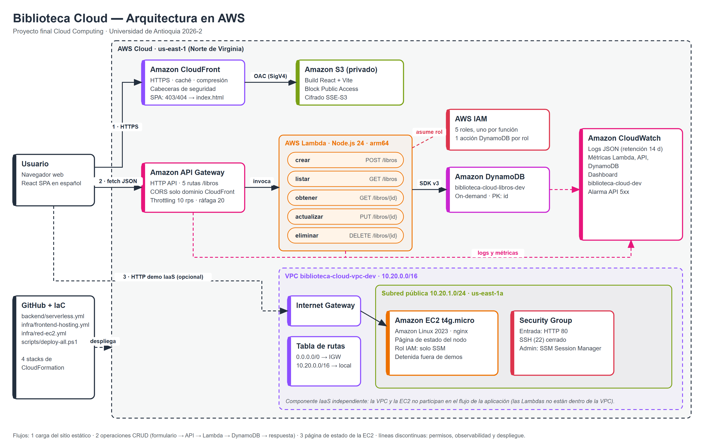

# Arquitectura — Biblioteca Cloud

Fuentes del diagrama: [SVG](arquitectura/biblioteca-cloud-arquitectura.svg) · [draw.io editable](arquitectura/biblioteca-cloud-arquitectura.drawio) · [generador](arquitectura/generar_diagrama.py) (`python docs/arquitectura/generar_diagrama.py`).

## Flujos

1. **Carga del sitio.** El navegador pide el sitio por HTTPS a CloudFront. Si el contenido no está en la caché, CloudFront lo lee del bucket S3 privado firmando la petición con OAC (SigV4). Las rutas inexistentes devuelven `index.html`, porque la aplicación es una SPA.
2. **Operaciones CRUD.** La aplicación React llama con `fetch` a la HTTP API de API Gateway. API Gateway revisa el CORS y el límite de peticiones, e invoca la Lambda que corresponde a la ruta. La Lambda asume su propio rol IAM y ejecuta una sola operación sobre DynamoDB (`PutItem`, `Scan`, `GetItem`, `UpdateItem` o `DeleteItem`). El resultado vuelve al navegador como JSON.
3. **Demostración IaaS (opcional).** Cuando la instancia EC2 está encendida, sirve por HTTP una página de estado. El tráfico entra a la subred pública por el Internet Gateway. Este flujo es independiente de la aplicación.

API Gateway, las Lambdas y DynamoDB envían sus logs y métricas a CloudWatch, que concentra el dashboard y la alarma de errores 5xx.

## Por qué cada servicio

| Servicio | Justificación |
| --- | --- |
| S3 | Almacena archivos estáticos de forma duradera y barata. Es el servicio que pide el enunciado para el frontend. |
| CloudFront | Da HTTPS sin comprar un dominio, cachea en el borde y permite mantener el bucket privado con OAC. |
| API Gateway (HTTP API) | Cuesta menos y tiene menos latencia que una REST API. Trae CORS y límite de peticiones integrados. |
| Lambda | Cómputo por demanda: solo se paga por invocación. Se reutilizan las 5 funciones del Laboratorio 3. |
| DynamoDB on-demand | Base NoSQL sin servidor que cobra por petición; el modelo `libro` cabe en una tabla con clave `id`. Es la opción que recomendó el docente para soluciones no relacionales. |
| IAM | Un rol por función, con una sola acción, sigue el principio de mínimo privilegio. |
| CloudWatch | Logs, métricas, dashboard y alarma, sin instalar agentes. |
| VPC + EC2 | Cubren los requisitos de IaaS y red del enunciado. Quedan aislados del backend porque la aplicación no los necesita; meter las Lambdas en la VPC exigiría un NAT Gateway (≈ USD 32 al mes) o endpoints, sin ningún beneficio. |

## Decisión: las Lambdas no están en la VPC

DynamoDB es un servicio público de AWS. Una Lambda dentro de una VPC sin salida a Internet necesitaría un NAT Gateway o un VPC endpoint para alcanzarlo. Eso aumentaría el costo y la complejidad sin mejorar la seguridad de este caso, porque los datos son públicos y el acceso ya está controlado por IAM. Por eso la VPC y la EC2 se presentan como un componente IaaS independiente, que se administra por SSM y se mantiene detenido fuera de las demostraciones.
